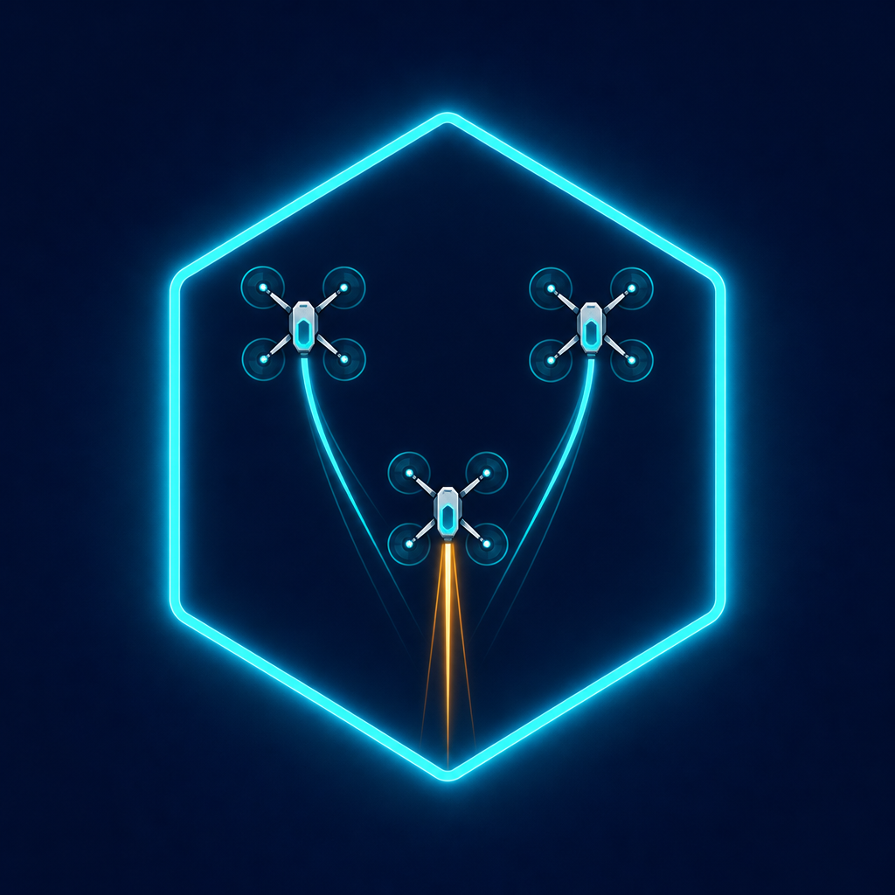
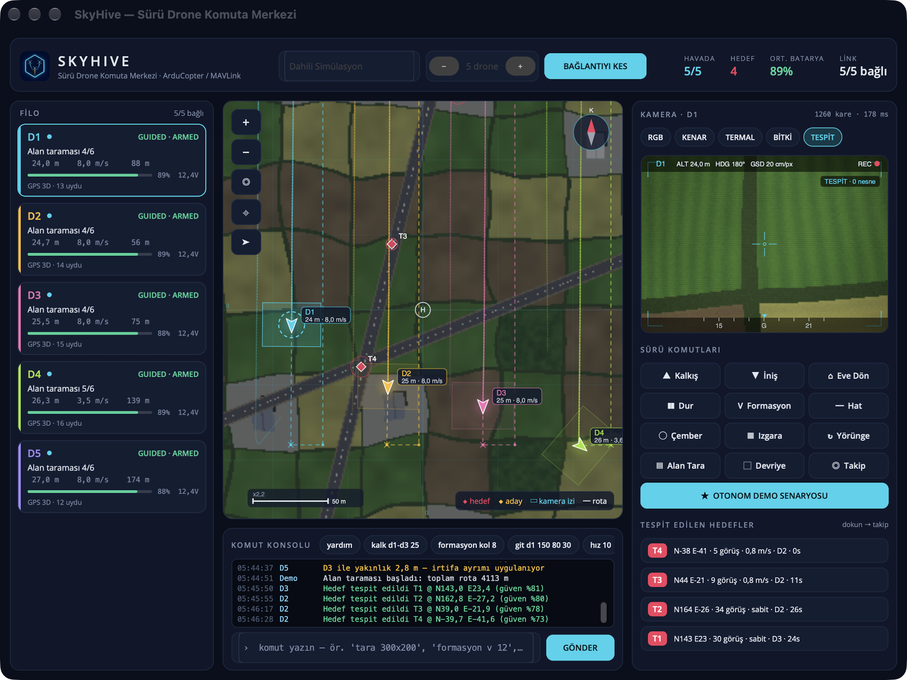
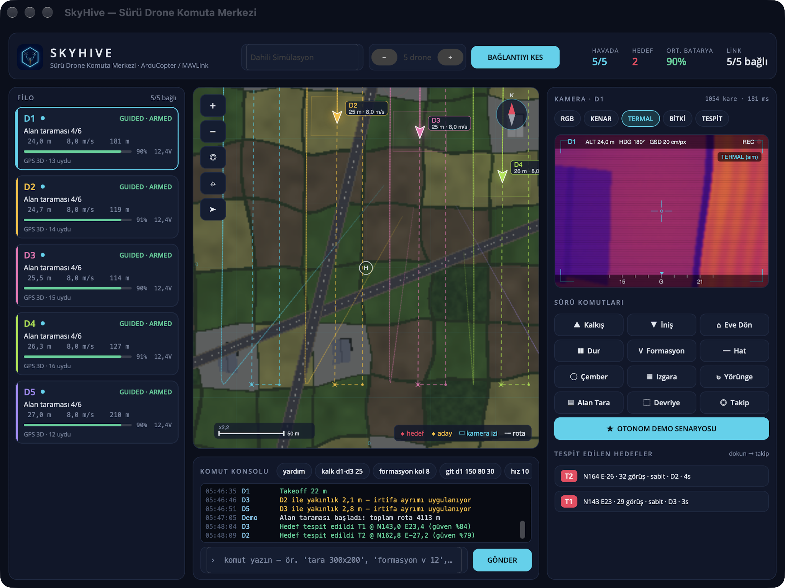

<p align="center"></p>

<h1 align="center">SkyHive</h1>
<p align="center"><b>.NET MAUI sürü drone komuta merkezi</b> — ArduCopter / ArduPilot SITL, MAVLink 2, otonom görevler ve görüntü işleme</p>



SkyHive bir drone sürüsünü tek ekrandan yönetir: komut yazarak ya da butonlarla kalkış, formasyon,
alan taraması, yörünge, devriye ve hedef takibi yaptırırsınız. Her drone'un kamerası görüntü işleme
hattından geçer; bulunan hedefler coğrafi konuma çevrilip sürünün ortak hedef listesine eklenir.

İki çalışma modu var:

| Mod | Ne işe yarar |
| --- | --- |
| **Dahili simülasyon** | Kurulum gerektirmez. ArduCopter davranışını taklit eden fizik modeli (GUIDED/LOITER/RTL/LAND, pre-arm, batarya failsafe, rüzgâr). |
| **ArduPilot SITL** | Gerçek ArduCopter yazılımı. Her araç MAVLink 2 üzerinden (TCP 5760+10·n ya da UDP) bağlanır. Aynı kod gerçek drone'a da bağlanır. |

## Özellikler

- **MAVLink 2** — bağımlılıksız, elle yazılmış ayrıştırıcı/kodlayıcı (v1 + v2, CRC_EXTRA, sıfır kırpma). Paketler testlerde `pymavlink` ile birebir karşılaştırılır.
- **Sürü kontrolcüsü** (4 Hz) — her drone'a görev atar ve GUIDED modda `SET_POSITION_TARGET_GLOBAL_INT` akıtır.
  - Formasyonlar: hat, kol, V (kama), çember, ızgara — lideri takip eder, lider hareket ettikçe döner.
  - Alan taraması: alanı drone sayısı kadar şeride böler, şerit aralığını kamera izine göre ayarlar (biçerdöver deseni).
  - Yörünge, kare devriye (döngü), hedefe git, askıda bekle, **hedef takibi** (hareketli hedefin etrafında yörünge).
  - Katmanlı irtifa ve yakınlık koruması (3 m'den yakın araçlarda otomatik irtifa ayrımı).
- **Görüntü işleme** (OpenCV'siz, saf C#, her platformda çalışır)
  - HSV renk eşikleme → morfolojik açma/kapama → bağlantılı bileşen etiketleme → blob → piksel→zemin dönüşümü.
  - Görünüm modları: RGB, Sobel kenar, sözde termal (ironbow), bitki indeksi (VARI), tespit kutuları.
  - Çoklu drone tespit füzyonu: yakın tespitleri birleştirir, hız tahmini yapar, 3 görüşte "doğrulandı" sayar.
  - SITL'de kamera olmadığı için kamera görüntüsü prosedürel bir dünyadan (tarlalar, yollar, göl, binalar, hareketli araçlar) drone'un konumuna, irtifasına ve yönüne göre sentezlenir.
- **Arayüz** — SkiaSharp ile çizilen taktik harita (iz, rota, kamera izi, hedefler, pusula, ölçek), canlı kamera HUD'u, filo kartları, komut konsolu. Geniş ekranda üç sütun, telefonda sekmeli düzen.



## Komut konsolu

Türkçe ya da İngilizce yazılabilir; `ı/ş/ğ/ü/ö/ç` olmadan da çalışır.

```
kalk 25                     tüm sürü GUIDED + arm + 25 m kalkış
kalk d1-d3 20               yalnızca D1..D3
formasyon v 12              V formasyonu, 12 m aralık, lider D1
formasyon çember 15 lider d2
git d1 150 80 30            D1 eve göre 150 m kuzey, 80 m doğu, 30 m irtifa
git d2 @40.9931,29.1251,25  coğrafi koordinata git
tara 320x240                alanı şeritlere bölüp tara
yörünge d2,d4 40            seçili dronlar 40 m yarıçapta yörünge
devriye 140                 140 m kare devriye
takip t3                    en yakın drone T3 hedefinin etrafında döner
hız 10 · dur · in · eve dön · hedefler · demo · yardım
```

Haritada **➤ (dokun-git)** açıkken haritaya dokununca seçili drone oraya uçar.

## Çalıştırma

Gereksinimler: .NET 10 SDK ve MAUI iş yükü (`dotnet workload install maui`). macOS'ta Xcode gerekir.

```bash
# Mac
dotnet build src/SkyHive.App -f net10.0-maccatalyst -t:Run

# Android (emülatör/cihaz)
dotnet build src/SkyHive.App -f net10.0-android -t:Run

# Windows
dotnet build src/SkyHive.App -f net10.0-windows10.0.19041.0 -t:Run
```

Uygulamayı `--demo` argümanıyla açarsanız simülasyona bağlanıp otonom senaryoyu (kalkış → V formasyonu → alan taraması) kendisi başlatır.

> MacCatalyst paketi kurulu Xcode sürümüyle eşleşmelidir. Hata "requires Xcode 27.2" derse ya Xcode'u güncelleyin ya da iş yükünü Xcode'unuza sabitleyin, ör. Xcode 26.4 için:
> `{"microsoft.net.sdk.ios":"26.4.10259/10.0.100","microsoft.net.sdk.maccatalyst":"26.4.10259/10.0.100"}` içeriğini bir dosyaya yazıp `dotnet workload update --from-rollback-file <dosya>`.

### ArduCopter SITL sürüsü

Docker ile (ArduCopter 4.5 derler, ilk kurulum birkaç dakika sürer):

```bash
cd sitl && COUNT=5 docker compose up --build
```

Sonra uygulamada **ArduPilot SITL (TCP)** seçin, `127.0.0.1` / `5760`, drone sayısı 5 → **BAĞLAN**.
SITL'in GPS/EKF hazırlığı açılıştan sonra 20–40 sn sürer; kalkış komutu bu sürede arm etmeyi tekrar dener.

ArduPilot kaynak kodu kuruluysa Docker'sız: `ARDUPILOT=~/ardupilot ./sitl/start-swarm.sh 5`.
MAVProxy/QGroundControl ile birlikte kullanmak için UDP modu: SITL'i `--out udp:127.0.0.1:14550` (+10·n) ile yönlendirip **ArduPilot SITL (UDP)** seçin.

### Terminalden (CLI)

```bash
dotnet run --project tools/SkyHive.Cli -- --sitl --count 3 \
  --script "kalk 15; bekle 35; formasyon v 10; git d1 60 40 20; bekle 30; yörünge 25; bekle 20; eve dön; bekle 30"
```

`--sitl` olmadan dahili simülasyonu kullanır; `--script` verilmezse etkileşimli konsol açılır.

## Proje yapısı

```
src/SkyHive.Core      MAVLink, simülatör, sürü kontrolcüsü, görevler, görüntü işleme, komut yorumlayıcı (net10.0)
src/SkyHive.App       .NET MAUI arayüzü (Android, iOS, macOS, Windows) — SkiaSharp harita ve kamera
tools/SkyHive.Cli     başsız konsol istemcisi
tests/                xUnit: MAVLink (pymavlink referans paketleri), geo, formasyon, simülatör, görüntü işleme, komutlar
sitl/                 ArduCopter SITL Dockerfile, docker-compose, sim_vehicle betiği
```

```bash
dotnet test tests/SkyHive.Core.Tests
```

## Güvenlik notu

Bu proje simülasyon ve eğitim amaçlıdır. Gerçek araçlarla kullanırken yerel havacılık kurallarına uyun,
görüş hattını koruyun ve her zaman manuel kontrolü (RC) devralabilecek durumda olun.
